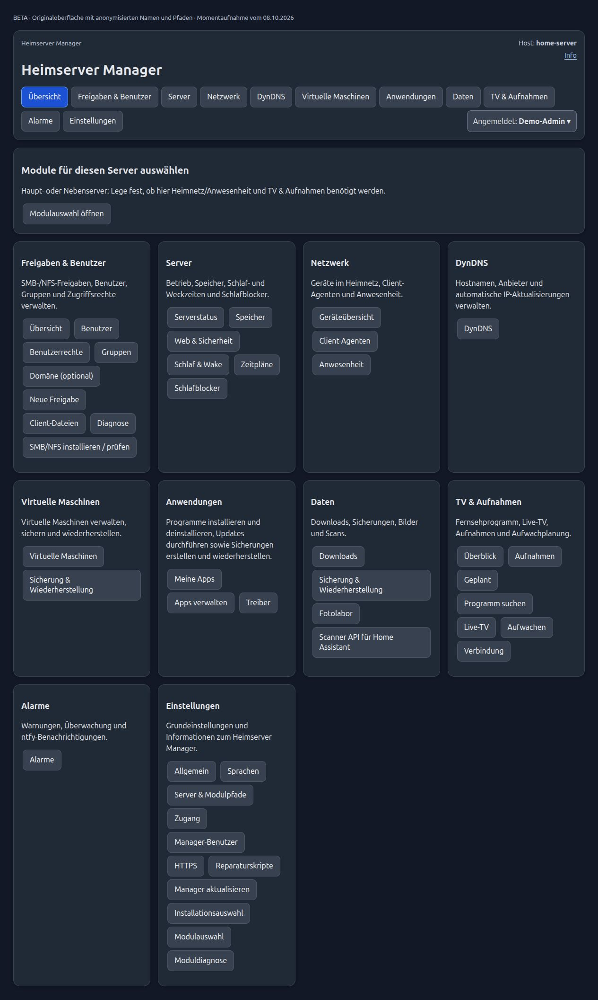
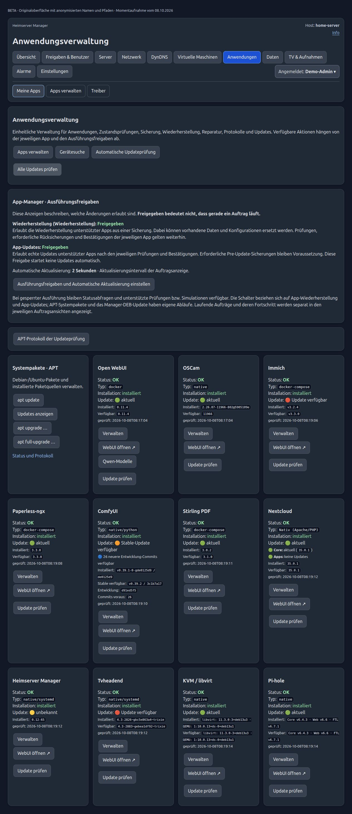
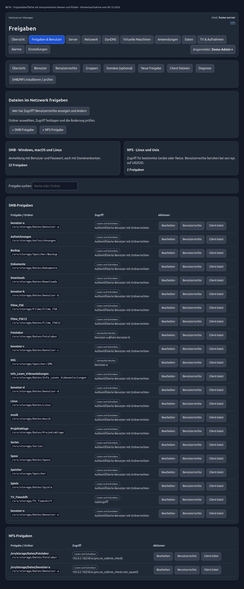
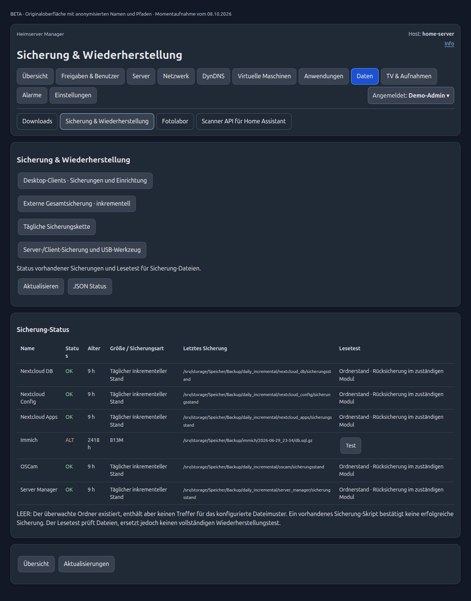
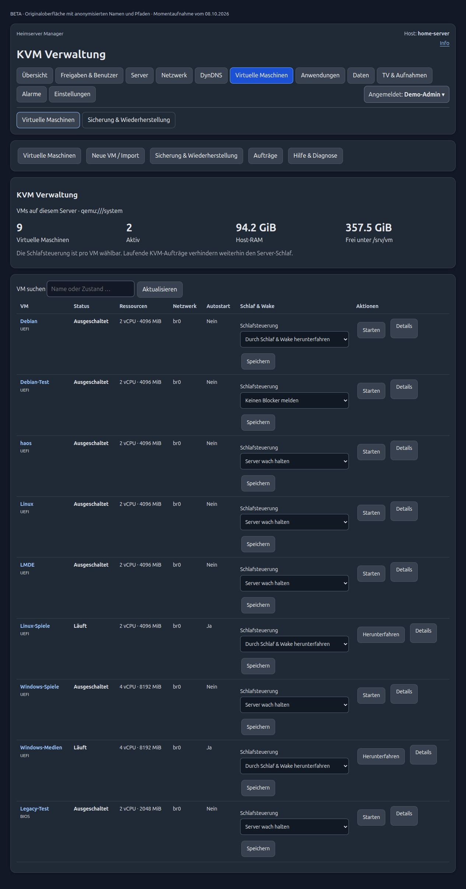
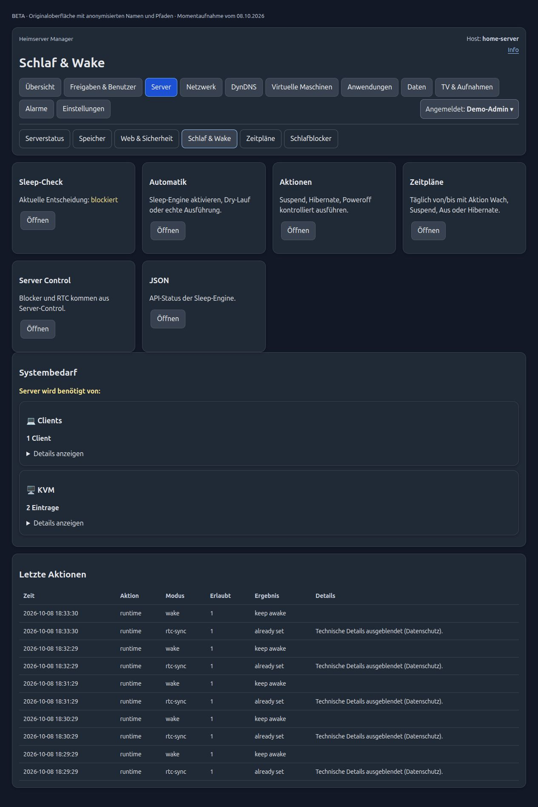
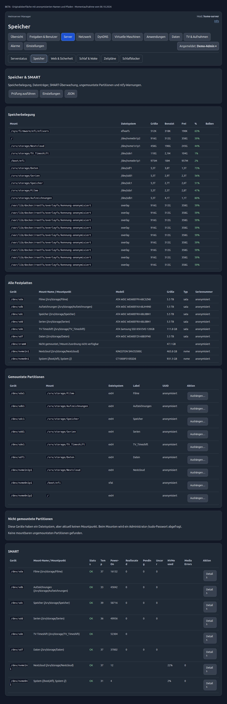
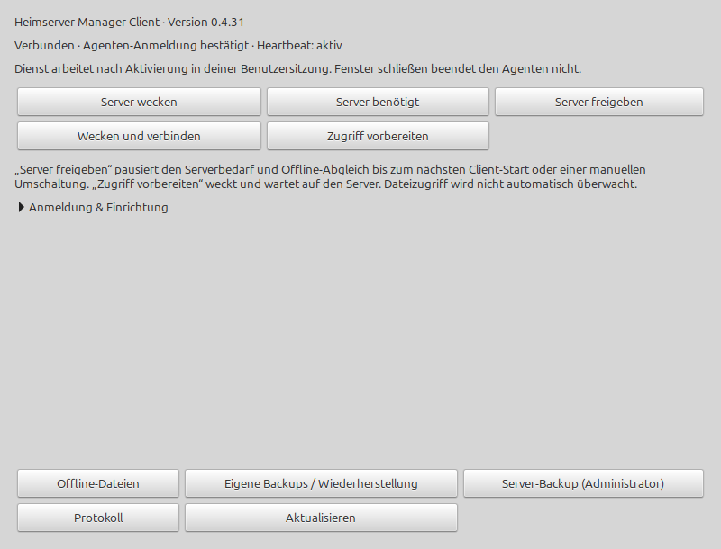
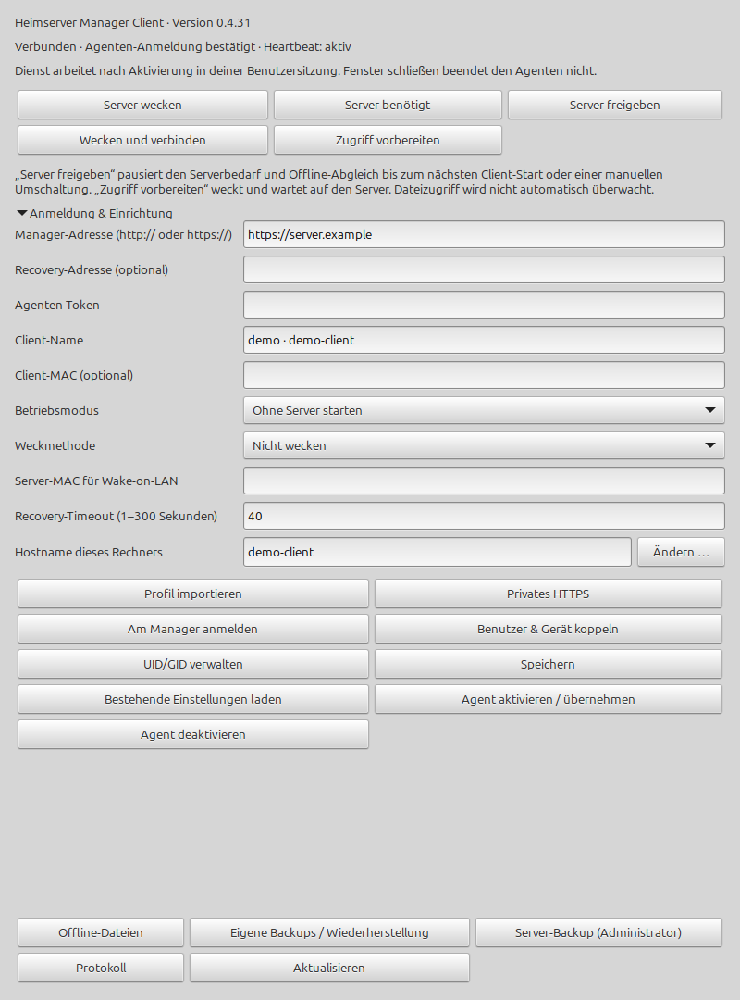

# Screenshots · Home Server Manager

Beta 0.12-65 · captured October 8, 2026. Browser screenshots of static copies of the actual German interface. Personal, host and VM names, paths, IP addresses, UUIDs and serial numbers have been anonymized; personal log details have been hidden. No AI-generated interfaces. Status and available features are snapshots and depend on the installation.

[German captions](../SCREENSHOTS.md) · [Project overview](README.md)

## Dashboard

## Applications and updates

## SMB and NFS shares

## Backup and recovery

## Virtual machines

## Sleep & Wake

## Storage and SMART

## Client Manager · Linux

Client 0.4.31 · captured on 11 October 2026. The actual GTK interface rendered with synthetic example values; the connection status is a demonstration, not a live connection. No personal profiles, tokens or network addresses were used. Windows styling may differ.

### Everyday controls

### Sign-in and setup

### Tray status icons

Original application icons, enlarged for clarity. Green confirms the agent connection; HTTPS reachability alone is not sufficient.

| No confirmed connection | Connecting | Agent connection confirmed |
| --- | --- | --- |
|  |  |  |
